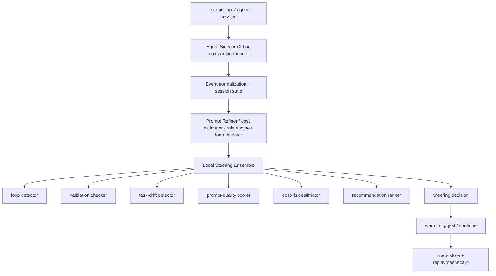

# Agent Sidecar Design Document

## 1. Executive Summary

Agent Sidecar is a local runtime layer that runs beside coding agents such as Codex and Claude Code in a separate terminal. It is not a replacement for those tools. It is a lightweight control plane that helps engineers spend fewer expensive coding-agent tokens, avoid repeated failed loops, refine prompts before execution, capture enough trace data to debug runs, and receive timely steering recommendations while preserving velocity.

The first product proof is intentionally small: start a local sidecar, register or create a Codex/Claude Code companion session, record basic events, and inspect a local trace. From there, Agent Sidecar adds prompt refinement, cost-aware prompt cleanup, local loop detection, validation reminders, and run replay.

The core design principle is critical functionality before polish. Agent Sidecar should prove it can reduce waste in real coding-agent workflows before investing in dashboards, branding, deep interception, advanced analytics, cloud sync, or enterprise policy features.

Agent Sidecar should be implemented across four main demo PRs:

1. **Local Sidecar Runtime + Companion Session MVP**: prove the sidecar runs locally beside Codex or Claude Code and records a real or simulated session.
2. **Prompt Refiner + Cost-Aware Prompt Optimization**: prove waste can be reduced before expensive agent execution.
3. **Local Steering Ensemble, Loop Detection, and Validation Guardrails**: prove wasteful runtime behavior can be detected with deterministic rules and cheap local evaluators instead of frequent frontier-model calls.
4. **Run Replay, MVP Dashboard, and Demo-Ready Analytics**: make runs understandable, replayable, and useful for debugging.

An optional fifth PR can add polished `pip` packaging if it does not fit cleanly into the first four PRs.

## 2. Product Goals and Non-Goals

### Goals

- Reduce coding-agent token spend by improving prompts and catching wasteful run patterns early.
- Prevent repeated failed loops such as rerunning the same failing test command without new evidence.
- Improve prompt quality before engineers paste tasks into Codex or Claude Code.
- Make coding-agent runs easier to debug through local traces, summaries, and replay.
- Keep engineers moving faster with clear CLI workflows and concise recommendations.
- Run locally beside existing tools rather than replacing Codex or Claude Code.
- Prefer deterministic rules and small local models before expensive remote frontier models.
- Make cost/token savings visible with estimates, avoided-waste summaries, and prompt before/after comparisons.
- Store raw traces locally by default and make exports explicit.
- Keep the system extensible so future local models, wrappers, and integrations can be added without rewriting the core runtime.

### Non-Goals for the First Four PRs

- Building a polished SaaS product.
- Replacing Codex, Claude Code, terminals, or IDEs.
- Full terminal interception as a hard MVP dependency.
- Enterprise data-loss-prevention workflows as the primary positioning.
- Mandatory cloud sync.
- Production-grade analytics, multi-user dashboards, billing, or org administration.
- Automated blocking of agent actions unless a future integration makes it safe and explicit.
- Frequent remote frontier-model calls for core runtime steering.

## 3. Target User Experience

### Primary Separate-Terminal Workflow

Terminal 1:

```bash
agent-sidecar start
```

Terminal 2:

```bash
codex
# or
claude
```

The user starts Agent Sidecar in one terminal, starts Codex or Claude Code in another terminal, and explicitly creates or associates a sidecar session with the agent run. If direct observation is unavailable, Agent Sidecar still provides value through companion commands, prompt refinement, manual event registration, wrapper commands, local trace capture, and session summaries.

### Initial MVP Interaction

```bash
agent-sidecar start
agent-sidecar session start --agent codex --repo . --name demo-session-001
agent-sidecar event command --session demo-session-001 --command "pnpm test"
agent-sidecar status
agent-sidecar session stop --session demo-session-001
agent-sidecar trace show demo-session-001
```

Expected visible output:

```text
Agent Sidecar running locally
Active session: demo-session-001
Repo: /path/to/repo
Agent: codex
Events recorded: 5
Estimated tokens: unavailable or estimated
Trace stored at: .agent-sidecar/sessions/demo-session-001.jsonl
```

### Prompt Refinement Workflow

```bash
agent-sidecar refine "make the app better and fix the tests"
```

Expected visible output:

```text
Prompt quality: Low
Issues detected:
- Task is vague
- Scope is too broad
- Validation expectations are missing
- No files or components identified

Refined prompt:
You are working in this repository. Inspect the failing tests first, identify the smallest code change needed, avoid unrelated refactors, and update only the files required to restore test correctness. After implementation, run the relevant test target and summarize the exact change made.

Estimated token savings:
- Original likely causes exploratory waste
- Refined prompt reduces ambiguity and narrows implementation scope
```

### Runtime Steering Workflow

During an active session, Agent Sidecar receives or observes repeated events and emits concise steering output:

```text
Steering decision: WARN
Confidence: 0.84

Evaluators fired:
- repeated_command_detector
- failed_test_loop_detector
- missing_validation_detector

Recommended next step:
Inspect the failing stack trace and update the specific dependency registration before rerunning the full test suite.

Estimated avoided waste:
- 2-3 repeated commands
- likely redundant test rerun
- potential unnecessary agent tokens
```

## 4. Critical User Flows

### Flow A: Start Sidecar Beside a Coding Agent

1. User runs `agent-sidecar start` in a terminal.
2. Sidecar starts a local runtime process and prints status.
3. User opens another terminal and starts `codex` or `claude`.
4. User creates or associates a session with `agent-sidecar session start --agent codex --repo .`.
5. Sidecar writes `session_started` to a local JSONL trace.
6. User can run `agent-sidecar status` to see active and recent sessions.

### Flow B: Refine Prompt Before Expensive Execution

1. User runs `agent-sidecar refine "raw task"`.
2. Prompt Refiner scores prompt quality and detects missing scope, constraints, files, and validation expectations.
3. Cost estimator computes rough original/refined token counts.
4. Sidecar prints a structured prompt that can be copied into Codex or Claude Code.
5. Sidecar records `prompt_submitted` and `prompt_refined` events linked to the active or most recent session.

### Flow C: Register or Observe Agent Events

1. Events arrive from manual CLI commands, a wrapper, command observation, log ingestion, or future integrations.
2. Event ingestion normalizes them into a shared event schema.
3. Session Manager appends events to the trace store.
4. Runtime evaluators update session state and cost estimates.
5. Sidecar status and summaries reflect the latest session state.

### Flow D: Detect Loop or Missing Validation

1. Session contains repeated commands, repeated failed tests, repeated file edits, or no validation after changes.
2. Local Steering Ensemble runs deterministic and local evaluators.
3. Evaluators emit findings with confidence, evidence, and suggested action.
4. Steering Decision Engine combines findings into `continue`, `warn`, or `suggest`.
5. Sidecar prints a concise recommendation and records a `steering_recommendation` event.

### Flow E: Replay and Export Run Summary

1. User runs `agent-sidecar replay demo-session-001` or opens the MVP dashboard.
2. Sidecar reads local JSONL traces and optional SQLite indexes.
3. User sees timeline events, prompt refinements, warnings, validation reminders, and cost rollups.
4. User exports Markdown or JSON summary with `agent-sidecar summary export demo-session-001 --format markdown`.

## 5. System Architecture

### High-Level Flow



### Component-Level Architecture

```text
+--------------------------------------------------------------------------------+
|                                Agent Sidecar                                   |
+--------------------------------------------------------------------------------+
| CLI Layer                                                                      |
| - start                                                                        |
| - status                                                                       |
| - session start/stop/list                                                      |
| - refine                                                                       |
| - event command/edit/test/failure                                              |
| - replay / summary export                                                      |
+-------------------------------------+------------------------------------------+
                                      |
                                      v
+--------------------------------------------------------------------------------+
| Local Runtime / Daemon                                                         |
| - local HTTP or IPC API                                                        |
| - runtime status                                                               |
| - watches active sessions                                                      |
| - emits terminal companion output                                              |
+-------------------------------------+------------------------------------------+
                                      |
                                      v
+--------------------------------------------------------------------------------+
| Session Manager + Event Ingestion                                              |
| - creates session IDs                                                          |
| - associates repo + agent                                                       |
| - normalizes manual, wrapper, log, shell, detector events                       |
| - maintains in-memory active session state                                     |
+-------------------------------------+------------------------------------------+
                                      |
                                      v
+--------------------------------------------------------------------------------+
| Analysis Components                                                            |
| - Prompt Refiner                                                               |
| - Cost / Token Estimator                                                       |
| - Rule Engine                                                                  |
| - Loop Detector                                                                |
| - Validation Reminder                                                          |
| - Task Drift Detector                                                          |
+-------------------------------------+------------------------------------------+
                                      |
                                      v
+--------------------------------------------------------------------------------+
| Local Steering Ensemble                                                        |
| - deterministic heuristics                                                     |
| - embedding similarity                                                         |
| - lightweight classifiers                                                      |
| - small local LLM evaluators where configured                                  |
| - recommendation ranker                                                        |
+-------------------------------------+------------------------------------------+
                                      |
                                      v
+--------------------------------------------------------------------------------+
| Steering Decision Engine                                                       |
| - continue / warn / suggest                                                    |
| - confidence scoring                                                           |
| - evaluator evidence                                                           |
| - concise terminal messages                                                    |
+-------------------------------------+------------------------------------------+
                                      |
                                      v
+--------------------------------------------------------------------------------+
| Local Persistence + Visibility                                                 |
| - JSONL trace files                                                            |
| - optional SQLite index                                                        |
| - config files                                                                 |
| - Markdown / JSON exports                                                      |
| - MVP dashboard or replay CLI                                                  |
+--------------------------------------------------------------------------------+
```

### Runtime Boundaries

- The CLI is the primary user interface for PRs 1-3.
- The daemon/runtime owns active sessions and writes traces.
- The dashboard/API layer is optional until PR 4.
- Local trace storage is the source of truth.
- Deeper Codex/Claude Code interception is a future integration, not a prerequisite for MVP value.

## 6. Component Design

### CLI Layer

Responsibilities:

- Provide explicit commands for all MVP flows.
- Keep workflows understandable and scriptable.
- Print concise status and recommendations.
- Avoid hidden behavior that users cannot debug.

Initial commands:

```bash
agent-sidecar start
agent-sidecar status
agent-sidecar session start --agent codex --repo . --name demo-session-001
agent-sidecar session stop --session demo-session-001
agent-sidecar session list
agent-sidecar event command --session demo-session-001 --command "pnpm test"
agent-sidecar event edit --session demo-session-001 --file packages/core/src/index.ts
agent-sidecar event test --session demo-session-001 --command "pnpm test" --status failed
agent-sidecar refine "raw prompt"
agent-sidecar replay demo-session-001
agent-sidecar summary export demo-session-001 --format markdown
```

### Local Runtime / Daemon

Responsibilities:

- Run locally and advertise readiness.
- Maintain active runtime state.
- Expose a local API for CLI commands and future dashboard reads.
- Stream or print terminal companion recommendations.
- Avoid requiring remote services for core MVP behavior.

MVP API shape:

```text
GET  /health
GET  /status
POST /sessions
GET  /sessions
GET  /sessions/:id
POST /sessions/:id/events
POST /sessions/:id/stop
POST /refine
GET  /sessions/:id/replay
POST /sessions/:id/export
```

The API can be HTTP on `127.0.0.1` or a local IPC mechanism. HTTP is easier to demo and dashboard-friendly.

### Session Manager

Responsibilities:

- Create stable session IDs.
- Associate sessions with repo path, agent type, start/stop timestamps, and configuration snapshot.
- Track event counts and lightweight token/cost metadata.
- Support partial observation without failing the run.
- Link prompt refinements to active or recent sessions.

Session lifecycle:

```text
created -> active -> stopped -> summarized/exported
```

### Event Ingestion Layer

Responsibilities:

- Normalize events from manual CLI, companion mode, wrappers, logs, shell history, and detector outputs.
- Validate event schema.
- Attach metadata such as repo path, agent, source, and confidence.
- Append to JSONL traces.
- Notify analysis components when relevant events arrive.

Sources:

- `cli`: direct user command.
- `companion`: sidecar terminal interaction.
- `wrapper`: future `agent-sidecar codex` or `agent-sidecar claude` wrapper.
- `manual`: explicit event registration.
- `detector`: generated by local evaluators.

### Prompt Refiner

Responsibilities:

- Score prompt quality.
- Detect vague scope, missing validation, missing constraints, lack of file/component hints, and overbroad intent.
- Produce a structured coding-agent prompt.
- Estimate original/refined token footprint and likely exploratory waste.
- Record prompt lineage.

Prompt Refiner output should include:

- Quality score: `low`, `medium`, `high`.
- Issues detected.
- Refined prompt.
- Suggested acceptance criteria.
- Testing expectations.
- What not to change.
- Estimated savings or waste avoided.

MVP implementation should start deterministic:

- Keyword and structure heuristics.
- Prompt length checks.
- Missing section detection.
- Optional local LLM rewrite if configured.

### Cost / Token Estimator

Responsibilities:

- Provide rough token estimates without depending on agent vendor APIs.
- Compare prompt before/after refinement.
- Track estimated command/test rerun waste.
- Summarize avoided waste in session summaries.

MVP estimator:

- Approximate tokens as `ceil(characters / 4)`.
- Assign configurable estimated token costs to repeated commands, broad searches, repeated failed test runs, and prompt ambiguity.
- Mark estimates clearly as approximate.

Future estimator:

- Agent-specific tokenizers.
- Model-specific pricing tables.
- Optional import from vendor usage logs.

### Rule Engine

Responsibilities:

- Evaluate deterministic repo and session rules.
- Enforce reminders without blocking by default.
- Support repository configuration.
- Feed findings into the Local Steering Ensemble.

Examples:

- Warn if full test suite is repeated multiple times after the same failure.
- Warn if files outside configured scope are edited.
- Remind user to run validation after file edits.
- Warn if generated files or lockfiles are touched without an associated command.

### Local Steering Ensemble

Responsibilities:

- Run multiple cheap local evaluators.
- Combine evaluator findings into recommendations.
- Explain which evaluators fired and why.
- Avoid frequent expensive remote calls.
- Allow future evaluator/model swaps without changing session/event infrastructure.

Detailed design appears in Section 10.

### Steering Decision Engine

Responsibilities:

- Convert evaluator findings into `continue`, `warn`, or `suggest`.
- Rank recommendations by likely waste avoided and confidence.
- Avoid noisy output.
- Record steering decisions in trace.

Decision levels:

```text
CONTINUE: no action needed; optionally update cost estimate.
SUGGEST: low/medium urgency improvement recommendation.
WARN: likely wasteful loop, missing validation, task drift, or risky behavior.
```

MVP should not auto-block. It should warn and suggest.

### Trace Store

Responsibilities:

- Store raw events as JSONL.
- Make traces inspectable with common tools.
- Support replay and export.
- Optionally maintain SQLite indexes for faster session listing and dashboard queries.

Storage layout:

```text
.agent-sidecar/
  config.json
  sessions/
    demo-session-001.jsonl
    demo-session-001.summary.md
  index.sqlite        # optional after PR 1
```

### Dashboard / API Layer

Responsibilities:

- Read local traces and summaries.
- Show timeline, prompt before/after, steering events, evaluator firings, and cost estimates.
- Provide a demo-ready view in PR 4.

MVP dashboard should be local-only and simple. A CLI replay view is acceptable if it demonstrates the debugging story clearly; a web UI can be added if it does not distract from core functionality.

### Configuration System

Responsibilities:

- Store repo settings, default agent, trace path, local model settings, evaluator thresholds, and optional provider config.
- Be human-readable.
- Support project-local config first.

Example:

```json
{
  "version": 1,
  "default_agent": "codex",
  "trace_dir": ".agent-sidecar/sessions",
  "steering": {
    "mode": "local",
    "remote_fallback": false,
    "loop_threshold": 0.82,
    "validation_required_after_edits": true
  },
  "models": {
    "embedding_provider": "local",
    "embedding_model": "all-MiniLM-L6-v2",
    "prompt_refiner_model": "optional-local-llm",
    "frontier_fallback": "disabled"
  },
  "rules": {
    "warn_on_repeated_failed_tests": true,
    "warn_on_out_of_scope_edits": true
  }
}
```

### Integration Strategy for Codex and Claude Code

The MVP strategy is companion-first:

- Do not require fragile terminal interception.
- Support manual session creation and event registration.
- Support prompt refinement before copying into Codex or Claude Code.
- Add wrapper commands where feasible.
- Add log or shell-history ingestion where feasible.
- Treat partial observation as normal and still produce useful summaries.

### Testing Strategy Component

Testing must be deterministic:

- Unit-test pure evaluators.
- Use fixture traces for replay.
- Use golden Markdown summaries.
- Avoid network-dependent tests in core PRs.
- Make optional local model tests opt-in.

## 7. Data Model and Event Schema

### Core Event Schema

Every event should conform to this schema:

```json
{
  "event_id": "uuid",
  "session_id": "string",
  "timestamp": "iso-8601",
  "event_type": "string",
  "source": "cli | companion | wrapper | manual | detector",
  "payload": {},
  "metadata": {
    "repo_path": "string",
    "agent": "codex | claude | unknown",
    "confidence": 0.0
  }
}
```

### Required Event Types

- `session_started`
- `session_stopped`
- `prompt_submitted`
- `prompt_refined`
- `agent_command_observed`
- `file_edit_observed`
- `test_run_observed`
- `test_failure_observed`
- `loop_detected`
- `validation_missing`
- `task_drift_detected`
- `steering_recommendation`
- `cost_estimate_updated`
- `summary_exported`

### Session Record

```json
{
  "session_id": "demo-session-001",
  "name": "demo-session-001",
  "agent": "codex",
  "repo_path": "/path/to/repo",
  "status": "active",
  "started_at": "2026-06-04T10:00:00Z",
  "stopped_at": null,
  "trace_path": ".agent-sidecar/sessions/demo-session-001.jsonl",
  "event_count": 5,
  "estimated_tokens": null,
  "estimated_cost_usd": null,
  "config_snapshot": {}
}
```

### Event Payload Examples

#### `session_started`

```json
{
  "event_type": "session_started",
  "payload": {
    "session_name": "demo-session-001",
    "cwd": "/path/to/repo"
  }
}
```

#### `prompt_submitted`

```json
{
  "event_type": "prompt_submitted",
  "payload": {
    "prompt_text": "make the app better and fix the tests",
    "estimated_tokens": 9
  }
}
```

#### `prompt_refined`

```json
{
  "event_type": "prompt_refined",
  "payload": {
    "quality": "low",
    "issues": ["vague_task", "missing_validation", "scope_too_broad"],
    "original_estimated_tokens": 9,
    "refined_estimated_tokens": 55,
    "refined_prompt": "Inspect the failing tests first...",
    "savings_explanation": "Reduced ambiguity and likely exploratory waste."
  }
}
```

#### `agent_command_observed`

```json
{
  "event_type": "agent_command_observed",
  "payload": {
    "command": "pnpm test",
    "cwd": "/path/to/repo",
    "exit_code": 1,
    "duration_ms": 32000
  }
}
```

#### `test_failure_observed`

```json
{
  "event_type": "test_failure_observed",
  "payload": {
    "command": "pnpm test",
    "failure_signature": "AuthRefreshProvider should refresh expired token",
    "test_target": "packages/auth",
    "stack_trace_excerpt": "AssertionError: expected 401 to equal 200"
  }
}
```

#### `loop_detected`

```json
{
  "event_type": "loop_detected",
  "source": "detector",
  "payload": {
    "loop_type": "repeated_failed_test",
    "evidence_event_ids": ["evt-1", "evt-2", "evt-3"],
    "summary": "Same failing test command repeated 3 times without new evidence.",
    "estimated_redundant_actions": 2
  },
  "metadata": {
    "confidence": 0.84
  }
}
```

#### `steering_recommendation`

```json
{
  "event_type": "steering_recommendation",
  "source": "detector",
  "payload": {
    "decision": "warn",
    "recommendation": "Inspect the failing stack trace before rerunning the full test suite.",
    "evaluators_fired": [
      "repeated_command_detector",
      "failed_test_loop_detector",
      "missing_validation_detector"
    ],
    "estimated_avoided_waste": {
      "repeated_commands": 2,
      "token_estimate": "approximate"
    }
  },
  "metadata": {
    "confidence": 0.84
  }
}
```

### Local Storage Expectations

- JSONL traces are the raw event source of truth.
- Optional SQLite can index sessions, timestamps, event types, and summary metadata.
- Config is stored in a project-local `.agent-sidecar/config.json` or user-level config when needed.
- Markdown and JSON summaries are exportable artifacts.
- Raw traces must remain inspectable without the dashboard.

## 8. Local-First Boundary Model

Agent Sidecar is local-first by default because local operation supports fast engineering workflows, debuggability, and cost-efficient steering.

Boundary rules:

- Raw traces are stored locally by default.
- Repo-sensitive details are not sent to remote services by default.
- Local models and deterministic rules power the core steering MVP.
- Remote/frontier models are optional fallbacks, not required dependencies.
- Users can inspect trace files, config, and exported summaries.
- Dashboard and replay read local traces first.
- Any cloud or remote call must be explicit, configurable, and visible in run metadata.
- If a remote fallback is added later, the event should record what summary was sent, which provider was used, and why the fallback was triggered.

This boundary model supports the product goal of reducing coding-agent waste. It is not the main positioning. The main value is engineering effectiveness: better prompts, fewer loops, lower token spend, and easier debugging.

## 9. Codex / Claude Code Companion Strategy

### Strategy 1: Separate-Terminal Companion Mode

This is the required MVP path.

1. User starts `agent-sidecar start`.
2. User starts `codex` or `claude` in another terminal.
3. User registers the session:

```bash
agent-sidecar session start --agent codex --repo .
```

4. Sidecar shows session status and stores events.
5. User manually registers commands, test runs, or failures when observation is partial.

Advantages:

- Reliable across tools.
- Does not depend on private terminal internals.
- Easy to demo in PR 1.
- Useful before deeper integrations exist.

Tradeoff:

- Some events are manual until wrappers/log ingestion improve observation.

### Strategy 2: Manual Session Registration

Manual registration is the fallback that must always work:

```bash
agent-sidecar session start --agent claude --repo /path/to/repo --name auth-fix
```

The session links all future prompt refinement and event commands to a trace.

### Strategy 3: Prompt Refinement Before Pasting

Users can refine prompts before spending tokens:

```bash
agent-sidecar refine "fix auth and tests"
```

The CLI prints a copyable prompt. If an active session exists, the prompt refinement is linked to that session. If no session exists, the refinement is stored as standalone history and can be attached later.

### Strategy 4: Wrapper Commands Where Feasible

Future wrappers can reduce manual event registration:

```bash
agent-sidecar codex
agent-sidecar claude
agent-sidecar run --session demo -- pnpm test
```

Wrappers can record command start/stop, exit codes, and failure snippets. They should not be required for PR 1.

### Strategy 5: Log/Event Ingestion Where Feasible

If Codex or Claude Code exposes logs, hooks, or transcript files, Agent Sidecar can ingest them through adapters. Adapters should emit the same normalized event schema.

### Strategy 6: Shell History or Command Observation Where Feasible

Shell-history ingestion can be useful but should be opt-in because shell history is noisy and incomplete. It should never be the only source of truth.

### Strategy 7: Future Deeper Integrations

Future work may include terminal multiplexing, PTY wrappers, IDE integrations, and agent-specific hooks. These should be built only after companion mode proves value.

### Partial Observation Behavior

When observation is partial:

- The session remains valid.
- Events include `source` and confidence metadata.
- Summaries clearly state what was observed vs inferred.
- Steering recommendations cite event evidence.
- Missing data should degrade gracefully, not fail the session.

## 10. Local Steering Ensemble Design

### Purpose

The Local Steering Ensemble detects wasteful coding-agent behavior during active sessions using deterministic checks, small local models, embeddings, and lightweight classifiers. It should not depend on frequent remote frontier-model calls.

### Ensemble Shape

```text
Local Steering Ensemble
├── Command similarity detector
├── Failed-test repetition detector
├── Repeated edit detector
├── Missing validation detector
├── Prompt/task drift detector
├── Prompt-quality scorer
├── Cost-risk estimator
├── Rule-based repo guardrail checker
└── Recommendation ranker
```

### Evaluator Contract

Each evaluator should implement a common interface:

```ts
type EvaluatorFinding = {
  evaluatorId: string;
  severity: "info" | "suggest" | "warn";
  confidence: number;
  evidenceEventIds: string[];
  summary: string;
  recommendation?: string;
  estimatedWaste?: {
    repeatedActions?: number;
    estimatedTokens?: number;
    notes?: string;
  };
};

type SteeringEvaluator = {
  id: string;
  evaluate(input: {
    session: SessionRecord;
    recentEvents: SidecarEvent[];
    config: SidecarConfig;
  }): Promise<EvaluatorFinding[]>;
};
```

Language can vary by implementation, but the interface should remain conceptually stable.

### Command Similarity Detector

Responsibilities:

- Detect repeated or near-identical commands.
- Use exact matching first.
- Use normalized command matching second.
- Use embeddings only when available.

Normalization examples:

- Strip repeated whitespace.
- Normalize absolute repo paths.
- Remove timestamps and temp filenames.
- Group test commands by target.

MVP trigger:

- Same command repeated 3 times in a session, or
- Same failed command repeated 2 times without intervening edit or diagnostic event.

### Failed-Test Repetition Detector

Responsibilities:

- Detect repeated failed tests with the same failure signature.
- Warn when the same test reruns without a changed strategy.
- Recommend inspecting the stack trace or narrowing test target.

MVP trigger:

- Same `test_failure_observed.failure_signature` appears twice with no relevant file edit or diagnostic event between failures.

### Repeated Edit Detector

Responsibilities:

- Detect repeated edits to the same file without validation or new evidence.
- Warn about thrashing behavior.

MVP trigger:

- Same file edited 3 times after the same failure signature and no successful validation.

### Missing Validation Detector

Responsibilities:

- Remind users when edits are not followed by tests, typechecks, lint, or build commands.
- Avoid blocking.

MVP trigger:

- File edit observed and no validation command within the next N events or before session stop.

### Prompt / Task Drift Detector

Responsibilities:

- Compare current commands and file edits to original/refined prompt intent.
- Warn when agent activity appears outside stated scope.

MVP implementation:

- Deterministic file-scope matching when prompt includes files/components.
- Keyword similarity between prompt and event payloads.
- Optional embeddings if configured.

### Prompt-Quality Scorer

Responsibilities:

- Score prompt before execution.
- Feed quality risks into cost-risk estimator.
- Encourage adding objective, scope, constraints, validation, and non-goals.

### Cost-Risk Estimator

Responsibilities:

- Estimate likelihood of wasteful trajectory.
- Combine repeated command count, failed test loops, missing validation, prompt ambiguity, and overbroad edits.

Example output:

```json
{
  "risk": "high",
  "confidence": 0.78,
  "drivers": ["repeated_failed_test", "missing_validation"],
  "estimated_redundant_actions": 3
}
```

### Rule-Based Repo Guardrail Checker

Responsibilities:

- Apply deterministic repo rules from config.
- Warn about out-of-scope changes.
- Remind about validation commands.
- Record evidence for summaries.

### Recommendation Ranker

Responsibilities:

- Combine findings into one concise recommendation.
- Prefer high-confidence deterministic findings.
- Avoid flooding terminal output.
- Explain which evaluators fired and why.

Ranking inputs:

- Severity.
- Confidence.
- Estimated waste avoided.
- Recency.
- Number of evaluators agreeing.
- Whether recommendation is actionable.

### Local Model Provider Abstraction

Agent Sidecar should allow local model providers to be swapped:

```text
ModelProvider
├── embed(texts) -> vectors
├── classify(input, labels) -> probabilities
└── suggest(input) -> short recommendation
```

MVP can ship with deterministic heuristics and optional local providers disabled by default. Future providers may include local embedding models, Ollama-hosted small LLMs, ONNX classifiers, or other near-local inference systems.

### Frontier Fallback Policy

Frontier models may be used later for optional fallback, evaluator calibration, or offline analysis. They must not be required for core PR 3 runtime steering.

Fallback should require:

- Explicit config enablement.
- Confidence threshold.
- High-value decision reason.
- Trace metadata showing fallback use.
- Compact summaries rather than raw traces by default.

## 11. MVP Roadmap

The roadmap is ordered by critical functionality:

1. **PR 1** proves the sidecar can exist as a local companion runtime and trace coding-agent sessions.
2. **PR 2** proves the sidecar can improve prompts before expensive execution.
3. **PR 3** proves the sidecar can detect runtime waste and produce local steering recommendations.
4. **PR 4** proves the sidecar can explain what happened through replay, summaries, and a minimal dashboard or CLI view.
5. **Optional PR 5** makes the project easy to install with `pip` if packaging is not already solved.

Avoid pulling PR 4 concerns into PR 1. Avoid model complexity before deterministic detection works. Avoid dashboard polish until there is meaningful trace data to display.

## 12. PR 1: Local Sidecar Runtime + Companion Session MVP

### Goal

Prove Agent Sidecar can run locally in a separate terminal beside Codex or Claude Code and record a basic coding-agent session.

### User-Visible Capability

- Start a local sidecar runtime.
- Create, list, inspect, and stop sessions.
- Register a repo and agent type.
- Record basic events.
- Inspect a local trace file.
- See session status with timestamps, repo path, agent, event count, and estimated token metadata when available.

### Backend / System Changes

- Add local runtime/daemon process.
- Add session manager.
- Add event ingestion and schema validation.
- Add JSONL trace writer and reader.
- Add config loader with project-local `.agent-sidecar/config.json`.
- Add basic status model.

### CLI / API Changes

Required CLI:

```bash
agent-sidecar start
agent-sidecar status
agent-sidecar session start --agent codex --repo . --name demo-session-001
agent-sidecar session list
agent-sidecar session stop --session demo-session-001
agent-sidecar event command --session demo-session-001 --command "pnpm test"
agent-sidecar trace show demo-session-001
```

Required local API:

```text
GET  /health
GET  /status
POST /sessions
GET  /sessions
POST /sessions/:id/events
POST /sessions/:id/stop
GET  /sessions/:id/trace
```

### Data Model Changes

- Introduce `SessionRecord`.
- Introduce base `SidecarEvent` schema.
- Support at least:
  - `session_started`
  - `session_stopped`
  - `agent_command_observed`
  - `cost_estimate_updated`

### Tests

- Unit tests for config loading.
- Unit tests for event schema validation.
- Unit tests for session lifecycle transitions.
- Unit tests for JSONL append/read.
- CLI tests for `start`, `status`, `session start`, `session stop`, and event registration.
- Integration test for session lifecycle and trace creation.

### Acceptance Criteria

- `agent-sidecar start` prints that the runtime is local and ready.
- User can start Codex or Claude Code separately without sidecar owning that process.
- User can create a session associated with `codex`, `claude`, or `unknown`.
- Sidecar records at least 5 events in JSONL during the demo.
- `agent-sidecar status` shows active session ID, repo, agent, event count, and trace path.
- Session can be stopped and trace can be inspected.

### Acceptance Demo Script

Setup:

```bash
pnpm install
pnpm build
```

Terminal 1:

```bash
agent-sidecar start
```

Terminal 2:

```bash
codex
# or claude
```

Terminal 3 or separate shell:

```bash
agent-sidecar session start --agent codex --repo . --name demo-session-001
agent-sidecar event command --session demo-session-001 --command "pnpm test"
agent-sidecar event command --session demo-session-001 --command "rg auth packages"
agent-sidecar event command --session demo-session-001 --command "pnpm test -- --runInBand"
agent-sidecar status
agent-sidecar session stop --session demo-session-001
agent-sidecar trace show demo-session-001
```

Expected visible output:

```text
Agent Sidecar running locally
Active session: demo-session-001
Repo: /path/to/repo
Agent: codex
Events recorded: 5
Estimated tokens: unavailable or estimated
Trace stored at: .agent-sidecar/sessions/demo-session-001.jsonl
```

Reviewer should verify:

- Trace file exists.
- Trace contains valid JSONL events.
- Session timestamps are present.
- Sidecar does not require remote services.
- Codex/Claude Code can run in a separate terminal.

Success looks like:

- A real local trace is created and readable.

Failure looks like:

- Runtime cannot start.
- Session cannot be created.
- Trace file is missing or invalid.
- Workflow requires full interception or remote model calls.

### What Should Not Be Included Yet

- Polished dashboard.
- Complex analytics.
- Full interception.
- Expensive model-based steering.
- Advanced packaging.
- Local Steering Ensemble beyond placeholder interfaces.

### Risks

- Manual event registration may feel basic.
- Daemon lifecycle could be overbuilt.
- CLI/API split may add complexity.

### Follow-Up Work

- Add prompt refinement in PR 2.
- Add real steering evaluators in PR 3.
- Add replay/dashboard in PR 4.

## 13. PR 2: Prompt Refiner + Cost-Aware Prompt Optimization

### Goal

Prove Agent Sidecar can reduce waste before the coding agent spends tokens.

### User-Visible Capability

- User can run `agent-sidecar refine "raw prompt"`.
- Sidecar prints prompt quality, detected issues, refined prompt, and estimated token/cost impact.
- Refined prompt can be copied into Codex or Claude Code.
- Prompt refinement links to the active or most recent session.

### Backend / System Changes

- Add Prompt Refiner module.
- Add deterministic prompt-quality scorer.
- Add prompt cleanup/compression logic.
- Add Cost / Token Estimator.
- Add prompt lineage storage.
- Add optional local model provider interface, but do not require a model.

### CLI / API Changes

Required CLI:

```bash
agent-sidecar refine "make the app better and fix the tests"
agent-sidecar refine --session demo-session-001 "raw task prompt here"
```

Required API:

```text
POST /refine
GET  /sessions/:id/prompts
```

### Data Model Changes

Add events:

- `prompt_submitted`
- `prompt_refined`
- `cost_estimate_updated`

Prompt refinement payload must include:

- Original prompt.
- Refined prompt.
- Quality score.
- Issues detected.
- Estimated original tokens.
- Estimated refined tokens.
- Savings explanation.
- Linked session ID if available.

### Tests

- Unit tests for prompt-quality scoring.
- Unit tests for vague prompt detection.
- Unit tests for missing validation detection.
- Unit tests for prompt cleanup/compression.
- Unit tests for token estimation.
- CLI tests for `refine` output.
- Integration tests linking refinement events to active session traces.

### Acceptance Criteria

- Vague prompt produces `Prompt quality: Low`.
- Output lists concrete issues.
- Refined prompt includes objective, scope boundaries, constraints, validation expectations, and output expectations.
- Token estimates are shown as approximate.
- Prompt refinement events are written to the session trace.
- No remote frontier model is required.

### Acceptance Demo Script

Setup:

```bash
pnpm build
agent-sidecar start
agent-sidecar session start --agent codex --repo . --name prompt-demo-001
```

Run:

```bash
agent-sidecar refine --session prompt-demo-001 "make the app better and fix the tests"
agent-sidecar trace show prompt-demo-001
```

Expected visible output:

```text
Prompt quality: Low
Issues detected:
- Task is vague
- Scope is too broad
- Validation expectations are missing
- No files or components identified

Refined prompt:
You are working in this repository. Inspect the failing tests first, identify the smallest code change needed, avoid unrelated refactors, and update only the files required to restore test correctness. After implementation, run the relevant test target and summarize the exact change made.

Estimated token savings:
- Original likely causes exploratory waste
- Refined prompt reduces ambiguity and narrows implementation scope
```

Reviewer should verify:

- Prompt is materially more actionable.
- Trace contains `prompt_submitted` and `prompt_refined`.
- No remote model is required.
- Output can be copied into Codex or Claude Code.

Success looks like:

- The prompt becomes specific enough for a coding agent to execute with less exploration.

Failure looks like:

- Refined prompt simply restates the original.
- No validation expectations are added.
- Output depends on an unavailable remote model.

### What Should Not Be Included Yet

- Runtime loop detection.
- Dashboard.
- Replay UI.
- Complex local model ensemble beyond prompt scoring/refinement.
- Automated prompt submission into Codex or Claude Code.

### Risks

- Deterministic prompt refinement can be too generic.
- Token savings are approximate.
- Over-refinement may create false specificity.

### Follow-Up Work

- Feed prompt-quality findings into runtime cost-risk scoring in PR 3.
- Show prompt history and before/after in PR 4.

## 14. PR 3: Local Steering Ensemble, Loop Detection, and Validation Guardrails

### Goal

Prove Agent Sidecar can reduce wasted agent loops during an active session using deterministic rules and smaller, cheaper local evaluators rather than expensive remote frontier models.

### User-Visible Capability

- Sidecar detects repeated commands, repeated failed tests, repeated edits, missing validation, and possible task drift.
- Sidecar prints `continue`, `suggest`, or `warn` decisions.
- Recommendations explain which evaluators fired and why.
- Run summary includes estimated waste avoided.

### Backend / System Changes

- Add Local Steering Ensemble abstraction.
- Add evaluator registry.
- Add command similarity detector.
- Add failed-test repetition detector.
- Add repeated edit detector.
- Add missing validation detector.
- Add prompt/task drift detector.
- Add cost-risk estimator.
- Add rule-based repo guardrail checker.
- Add recommendation ranker.
- Add confidence scoring.
- Add optional local model provider configuration.
- Keep remote fallback disabled by default.

### CLI / API Changes

Required CLI additions:

```bash
agent-sidecar event test --session demo --command "pnpm test" --status failed --failure-signature "AuthRefresh failure"
agent-sidecar event edit --session demo --file packages/auth/src/refresh.ts
agent-sidecar steer --session demo
```

The runtime may also run steering automatically after relevant events:

```text
Steering decision: WARN
Confidence: 0.84
```

Required API:

```text
POST /sessions/:id/steer
GET  /sessions/:id/recommendations
```

### Data Model Changes

Add events:

- `file_edit_observed`
- `test_run_observed`
- `test_failure_observed`
- `loop_detected`
- `validation_missing`
- `task_drift_detected`
- `steering_recommendation`

Add evaluator finding model:

```json
{
  "evaluator_id": "failed_test_loop_detector",
  "severity": "warn",
  "confidence": 0.84,
  "evidence_event_ids": ["evt-1", "evt-2"],
  "summary": "Same failing test repeated without new evidence.",
  "recommendation": "Inspect stack trace before rerunning full test suite."
}
```

### Tests

- Unit tests for exact repeated command detection.
- Unit tests for normalized command similarity.
- Unit tests for repeated failed-test detection.
- Unit tests for repeated edit detection.
- Unit tests for missing validation detection.
- Unit tests for task-drift heuristics.
- Unit tests for cost-risk scoring.
- Unit tests for recommendation ranking.
- Integration tests feeding fixture event streams and asserting steering output.
- Tests proving remote fallback is disabled by default.

### Acceptance Criteria

- Repeating the same failed test command triggers a loop warning.
- Repeated edits without validation trigger a validation reminder.
- The steering decision includes confidence and evaluator names.
- The recommendation is concise and actionable.
- The run summary includes estimated avoided waste.
- Core steering works without remote frontier model calls.

### Acceptance Demo Script

Setup:

```bash
pnpm build
agent-sidecar start
agent-sidecar session start --agent codex --repo . --name steering-demo-001
```

Run:

```bash
agent-sidecar event test --session steering-demo-001 --command "pnpm test" --status failed --failure-signature "AuthRefresh failure"
agent-sidecar event test --session steering-demo-001 --command "pnpm test" --status failed --failure-signature "AuthRefresh failure"
agent-sidecar event edit --session steering-demo-001 --file packages/auth/src/refresh.ts
agent-sidecar event edit --session steering-demo-001 --file packages/auth/src/refresh.ts
agent-sidecar event edit --session steering-demo-001 --file packages/auth/src/refresh.ts
agent-sidecar steer --session steering-demo-001
```

Expected visible output:

```text
Agent Sidecar detected a likely loop:
- Similar failing test command repeated 3 times
- Same file edited repeatedly without new evidence
- No new validation strategy attempted

Recommended next step:
Inspect the failing stack trace and update the specific dependency registration before rerunning the full test suite.

Steering decision: WARN
Confidence: 0.84

Evaluators fired:
- repeated_command_detector
- failed_test_loop_detector
- missing_validation_detector

Estimated avoided waste:
- 2-3 repeated commands
- likely redundant test rerun
- potential unnecessary agent tokens
```

Reviewer should verify:

- Warning is generated from local deterministic/local evaluators.
- Trace contains detector events and steering recommendation.
- Output includes evaluator evidence.
- Remote fallback is not required or used.

Success looks like:

- The sidecar catches a plausible waste loop and recommends a better next step.

Failure looks like:

- No loop is detected.
- Output is generic or unactionable.
- Steering requires an expensive remote model.

### What Should Not Be Included Yet

- Polished replay dashboard.
- Full analytics UI.
- Automated blocking unless explicitly safe.
- Remote frontier model dependency as the default path.

### Risks

- Heuristics may produce false positives.
- Too many warnings can slow engineers down.
- Embedding setup may be environment-dependent.
- Task drift is hard with partial observation.

### Follow-Up Work

- Add evaluator tuning from fixture traces.
- Add dashboard/replay visibility in PR 4.
- Add optional local embeddings after deterministic detectors are stable.

## 15. PR 4: Run Replay, MVP Dashboard, and Demo-Ready Analytics

### Goal

Make Agent Sidecar demonstrable and useful for debugging agent runs.

### User-Visible Capability

- View timeline/replay for a previous run.
- See prompt refinement history.
- See loop detections, validation reminders, steering recommendations, and cost estimates.
- Export Markdown or JSON run summaries.
- Optionally open a local dashboard.
- Search/list sessions.

### Backend / System Changes

- Add replay reader over JSONL traces.
- Add summary generator.
- Add optional SQLite session/event index if needed for dashboard speed.
- Add dashboard API endpoints.
- Add local web UI or robust CLI replay view.
- Add summary export writer.

### CLI / API Changes

Required CLI:

```bash
agent-sidecar session list
agent-sidecar replay demo-session-001
agent-sidecar summary export demo-session-001 --format markdown
agent-sidecar dashboard
```

Required API:

```text
GET  /sessions
GET  /sessions/:id/replay
GET  /sessions/:id/summary
POST /sessions/:id/export
```

### Data Model Changes

Add events:

- `summary_exported`

Add summary model:

```json
{
  "session_id": "demo-session-001",
  "agent": "codex",
  "repo_path": "/path/to/repo",
  "prompt_refinement": {
    "original_quality": "low",
    "issues": ["vague_task", "missing_validation"]
  },
  "steering_events": [
    "Detected repeated failing test command",
    "Recommended inspecting stack trace before rerun"
  ],
  "estimated_waste_avoided": {
    "redundant_test_runs": 2,
    "repeated_search_loops": 1
  },
  "recommended_follow_up": [
    "Add targeted validation earlier in future prompts."
  ]
}
```

### Tests

- Unit tests for replay ordering.
- Unit tests for summary generation.
- Golden-file tests for Markdown summary output.
- Integration tests for dashboard/replay API.
- CLI tests for session listing and export.
- Fixture-based tests with PR 1-3 event streams.

### Acceptance Criteria

- User can view previous sessions.
- User can replay a session timeline.
- User can see prompt before/after and quality issues.
- User can see evaluator firings and steering recommendations.
- User can see estimated token/cost/waste rollups.
- User can export a Markdown summary.
- Dashboard or CLI replay reads local traces without cloud dependency.

### Acceptance Demo Script

Setup:

```bash
pnpm build
agent-sidecar start
```

Create demo data using prior PR flows:

```bash
agent-sidecar session start --agent codex --repo . --name demo-session-001
agent-sidecar refine --session demo-session-001 "make the app better and fix the tests"
agent-sidecar event test --session demo-session-001 --command "pnpm test" --status failed --failure-signature "AuthRefresh failure"
agent-sidecar event test --session demo-session-001 --command "pnpm test" --status failed --failure-signature "AuthRefresh failure"
agent-sidecar event edit --session demo-session-001 --file packages/auth/src/refresh.ts
agent-sidecar steer --session demo-session-001
agent-sidecar session stop --session demo-session-001
```

Replay and export:

```bash
agent-sidecar replay demo-session-001
agent-sidecar summary export demo-session-001 --format markdown
agent-sidecar dashboard
```

Expected summary output:

```markdown
# Agent Sidecar Run Summary

Session: demo-session-001
Agent: codex
Repo: /path/to/repo

## Prompt Refinement
Original prompt was vague and missing validation criteria.
Refined prompt added scope, constraints, and test expectations.

## Steering Events
- Detected repeated failing test command
- Detected repeated edits to the same file
- Recommended inspecting stack trace before rerunning test suite

## Estimated Waste Avoided
- 2 redundant test runs
- 1 repeated search loop
- Reduced prompt ambiguity before execution

## Recommended Follow-Up
Add targeted validation earlier in future prompts.
```

Reviewer should verify:

- Replay timeline matches trace order.
- Prompt history is visible.
- Steering evaluator names are visible.
- Summary is exportable and useful for debugging.
- Dashboard/replay is local-only.

Success looks like:

- Reviewer can answer, “What happened during this agent run and where was waste avoided?”

Failure looks like:

- Replay omits important events.
- Summary is too generic.
- Dashboard requires cloud services.

### What Should Not Be Included Yet

- Heavy production analytics.
- Multi-user SaaS backend.
- Enterprise policy management.
- Mandatory cloud sync.
- Complex charts that do not support the demo story.

### Risks

- Dashboard polish can distract from core functionality.
- Summary quality depends on event quality.
- SQLite index may be unnecessary complexity for MVP.

### Follow-Up Work

- Add better filtering/search.
- Add richer cost model.
- Add improved wrapper integrations.

## 16. Optional PR 5: pip Installation and Packaging

### Goal

Make Agent Sidecar installable and runnable with `pip` if packaging does not fit cleanly into the first four PRs.

### User-Visible Capability

```bash
pip install agent-sidecar
agent-sidecar --version
agent-sidecar start
agent-sidecar refine "Implement this feature with tests"
```

### Backend / System Changes

- Introduce Python package structure if the project is implemented in Python.
- Add packaging metadata.
- Ensure CLI entry point works after install.
- Keep local trace/config paths stable.

If the project remains TypeScript-first, this PR should either be skipped or reframed as packaging for the selected runtime. Do not force Python packaging if it conflicts with the implementation stack.

### CLI / API Changes

- Add `agent-sidecar --version`.
- Ensure installed CLI supports `start`, `status`, `session`, `refine`, and `replay`.

### Data Model Changes

- No required schema changes.
- Add package version to runtime metadata and summaries.

### Tests

- Package build smoke test.
- Local install smoke test.
- CLI version smoke test.
- Start/refine/session smoke tests after install.

### Acceptance Criteria

- Package installs in a clean environment.
- `agent-sidecar --version` prints version.
- `agent-sidecar start` runs.
- `agent-sidecar refine` works.
- Installed CLI can create and inspect a demo session.

### Acceptance Demo Script

```bash
python -m venv .venv
. .venv/bin/activate
pip install agent-sidecar
agent-sidecar --version
agent-sidecar start
agent-sidecar refine "Implement this feature with tests"
agent-sidecar session start --agent codex --repo . --name pip-demo-001
agent-sidecar status
```

Reviewer should verify:

- Installed CLI works outside source checkout assumptions.
- Version metadata is visible.
- Existing PR 1-4 demos still work.

### What Should Not Be Included Yet

- Cloud-hosted package workflows unless required.
- Cross-platform installers beyond pip.
- Telemetry.

### Risks

- Packaging may distract from runtime value.
- Current implementation stack may not be Python.
- Name availability may be unresolved.

### Follow-Up Work

- Publish package after name and distribution strategy are confirmed.
- Add CI package build.

## 17. Testing Strategy

Testing should favor deterministic, repeatable tests with fixture traces and no required network calls.

### Unit Tests

- CLI command parsing and output formatting.
- Config loading and defaults.
- Event schema validation.
- Session lifecycle transitions.
- JSONL trace write/read.
- Prompt-quality scoring.
- Prompt refinement sections and constraints.
- Token/cost estimation.
- Command normalization.
- Local steering evaluators.
- Loop detection.
- Validation reminder detection.
- Task-drift heuristics.
- Recommendation ranking.
- Summary generation.

### Integration Tests

- Session lifecycle creates valid trace.
- Prompt refinement links to active session.
- Fixture event stream triggers loop warning.
- Fixture event stream triggers missing validation reminder.
- Replay reads events in timestamp order.
- Summary export writes Markdown and JSON.
- Dashboard/API reads local traces.

### Golden-File Tests

- Prompt refinement output for representative vague prompts.
- Steering warning output for repeated failure loops.
- Markdown run summary.
- JSON export shape.

### Demo Smoke Tests

Each PR should include a script or documented command sequence that exercises the demo path. The smoke tests should be runnable locally without Codex or Claude Code by simulating events manually.

### Local Model Tests

- Optional and skipped by default.
- Should not fail CI if a local model provider is unavailable.
- Deterministic evaluator tests must cover core behavior without model inference.

### Packaging Smoke Test for Optional PR 5

- Build package.
- Install in clean environment.
- Run `agent-sidecar --version`.
- Run `agent-sidecar start`.
- Run `agent-sidecar refine`.
- Create and inspect a demo session.

## 18. Acceptance Demo Matrix

| PR | Demo Focus | Setup Commands | Demo Commands | Expected Visible Output | Reviewer Verifies |
| --- | --- | --- | --- | --- | --- |
| PR 1 | Local sidecar runtime beside Codex/Claude Code | `pnpm install`, `pnpm build` | `agent-sidecar start`, `agent-sidecar session start --agent codex --repo . --name demo-session-001`, event commands, `agent-sidecar status`, `agent-sidecar trace show demo-session-001` | `Agent Sidecar running locally`, active session details, trace path | Runtime starts locally, session trace exists, events are valid JSONL |
| PR 2 | Prompt refinement before expensive execution | `pnpm build`, start runtime/session | `agent-sidecar refine --session prompt-demo-001 "make the app better and fix the tests"` | Prompt quality, issues detected, refined prompt, estimated savings | Prompt is actionable, linked events are written, no remote model required |
| PR 3 | Local steering and loop detection | `pnpm build`, start runtime/session | repeated `event test`, repeated `event edit`, `agent-sidecar steer --session steering-demo-001` | `Steering decision: WARN`, confidence, evaluators fired, avoided waste | Deterministic/local evaluators detect loop and recommend next action |
| PR 4 | Replay, summary, MVP dashboard | `pnpm build`, create demo trace using prior flows | `agent-sidecar replay demo-session-001`, `agent-sidecar summary export demo-session-001 --format markdown`, `agent-sidecar dashboard` | run timeline, prompt history, steering events, Markdown summary | Reviewer can debug what happened and why waste was avoided |
| PR 5 | Optional installability | create virtualenv | `pip install agent-sidecar`, `agent-sidecar --version`, `agent-sidecar start`, `agent-sidecar refine "Implement this feature with tests"` | installed CLI works | Package can be installed and core commands run |

## 19. Risks and Tradeoffs

### Companion Mode vs Deep Interception

- **Tradeoff**: Companion mode is reliable but less automatic.
- **Decision**: Start with companion mode because it proves value without fragile integration risk.
- **Mitigation**: Add wrappers and log ingestion after PR 1.

### Deterministic Heuristics vs Local Models

- **Tradeoff**: Heuristics are predictable but can miss semantic loops.
- **Decision**: Favor deterministic rules first, then add optional local embeddings/classifiers.
- **Mitigation**: Use fixture traces to tune thresholds.

### Warning Noise

- **Risk**: Too many warnings can slow engineers down.
- **Mitigation**: Rank recommendations, suppress duplicate warnings, and require evidence for `WARN`.

### Approximate Cost Estimates

- **Risk**: Token/cost estimates may be imprecise.
- **Mitigation**: Label estimates as approximate and focus on relative waste avoided.

### Partial Observation

- **Risk**: Manual or incomplete events can reduce recommendation accuracy.
- **Mitigation**: Store event source/confidence and degrade gracefully.

### Dashboard Scope Creep

- **Risk**: UI polish can delay core functionality.
- **Mitigation**: Require PR 4 dashboard/replay to answer one question: “What happened during this run?”

### Local Model Availability

- **Risk**: Local model setup varies across machines.
- **Mitigation**: Core PR 3 steering must work without local model inference; model providers are optional extensions.

### Packaging Stack Mismatch

- **Risk**: Optional pip packaging may not match the project’s implementation language.
- **Mitigation**: Treat PR 5 as optional and avoid delaying PRs 1-4.

## 20. Open Questions

1. What implementation stack should Agent Sidecar use long-term: TypeScript, Python, or a hybrid?
2. Should PR 1 use local HTTP, IPC, or direct CLI file writes for daemon communication?
3. Should session IDs be user-provided, generated, or both?
4. Which Codex and Claude Code logs or hooks are stable enough to ingest later?
5. Which local embedding/model provider should be the first optional implementation?
6. What default thresholds minimize warning noise while catching real loops?
7. Should prompt refinement be deterministic-only in PR 2 or optionally local-LLM-assisted?
8. Is a web dashboard necessary in PR 4, or is CLI replay plus Markdown export enough for the first demo?
9. How should estimated cost be represented when the actual model and token usage are unknown?
10. Should project-local `.agent-sidecar` be committed, ignored, or partially ignored by default?
11. What is the minimum useful wrapper for `codex` or `claude` without creating brittle process-control behavior?
12. If pip packaging is required, should the project move to Python or provide a thin Python launcher for another runtime?

## 21. Final Implementation Checklist for Coding Agent

### PR 1 Checklist: Local Sidecar Runtime + Companion Session MVP

- [ ] Add or finalize CLI entry point for `agent-sidecar`.
- [ ] Implement `agent-sidecar start` with local runtime readiness output.
- [ ] Implement config loader and default `.agent-sidecar/config.json` creation.
- [ ] Implement `SessionRecord` model.
- [ ] Implement base `SidecarEvent` schema validation.
- [ ] Implement JSONL trace writer and reader.
- [ ] Implement `session start`, `session list`, `session stop`.
- [ ] Implement `event command` manual registration.
- [ ] Implement `status` output with active session, repo, agent, event count, estimated token metadata, and trace path.
- [ ] Implement `trace show`.
- [ ] Add unit tests for config, schema, session lifecycle, and trace storage.
- [ ] Add integration test for creating/stopping a session and inspecting trace.
- [ ] Document acceptance demo.
- [ ] Do not add dashboard polish or model steering yet.

### PR 2 Checklist: Prompt Refiner + Cost-Aware Prompt Optimization

- [ ] Implement Prompt Refiner module.
- [ ] Implement deterministic prompt-quality scorer.
- [ ] Detect vague task, broad scope, missing validation, missing constraints, and missing files/components.
- [ ] Implement prompt cleanup/compression and structured prompt generation.
- [ ] Implement rough token estimator.
- [ ] Implement `agent-sidecar refine` CLI.
- [ ] Link prompt refinement to active or specified session.
- [ ] Record `prompt_submitted`, `prompt_refined`, and `cost_estimate_updated` events.
- [ ] Add unit tests for prompt scoring, refinement, and token estimation.
- [ ] Add integration test for refinement events in trace.
- [ ] Document acceptance demo.
- [ ] Do not add runtime loop detection or dashboard yet.

### PR 3 Checklist: Local Steering Ensemble, Loop Detection, and Validation Guardrails

- [ ] Implement evaluator interface and registry.
- [ ] Implement command normalization.
- [ ] Implement repeated command detector.
- [ ] Implement failed-test repetition detector.
- [ ] Implement repeated edit detector.
- [ ] Implement missing validation detector.
- [ ] Implement prompt/task drift heuristic detector.
- [ ] Implement cost-risk estimator.
- [ ] Implement rule-based repo guardrail checker.
- [ ] Implement recommendation ranker.
- [ ] Implement Steering Decision Engine with `continue`, `suggest`, and `warn`.
- [ ] Implement `agent-sidecar steer --session`.
- [ ] Auto-run steering after relevant event ingestion if feasible.
- [ ] Record `loop_detected`, `validation_missing`, `task_drift_detected`, and `steering_recommendation` events.
- [ ] Add tests for all evaluators and ranking behavior.
- [ ] Add integration fixture that triggers expected `WARN` output.
- [ ] Prove remote frontier fallback is disabled by default.
- [ ] Document acceptance demo.
- [ ] Do not add automated blocking or remote model dependency.

### PR 4 Checklist: Run Replay, MVP Dashboard, and Demo-Ready Analytics

- [ ] Implement replay reader over local JSONL traces.
- [ ] Implement `agent-sidecar replay`.
- [ ] Implement summary generator.
- [ ] Implement Markdown and JSON summary export.
- [ ] Implement `agent-sidecar summary export`.
- [ ] Implement `session list` filtering/search if not already adequate.
- [ ] Add minimal local dashboard or robust CLI replay view.
- [ ] Show prompt refinement before/after.
- [ ] Show steering events and evaluators fired.
- [ ] Show estimated token/cost/waste rollups.
- [ ] Add golden-file tests for summaries.
- [ ] Add integration tests for replay/export.
- [ ] Document acceptance demo.
- [ ] Do not add heavy analytics, SaaS backend, or cloud sync.

### Optional PR 5 Checklist: pip Installation and Packaging

- [ ] Confirm implementation stack and packaging strategy.
- [ ] Add package metadata.
- [ ] Add console script entry point.
- [ ] Add `agent-sidecar --version`.
- [ ] Add install docs.
- [ ] Add package build smoke test.
- [ ] Add clean-environment install smoke test.
- [ ] Verify `start`, `refine`, and session commands after install.
- [ ] Do not delay PRs 1-4 for packaging polish.
